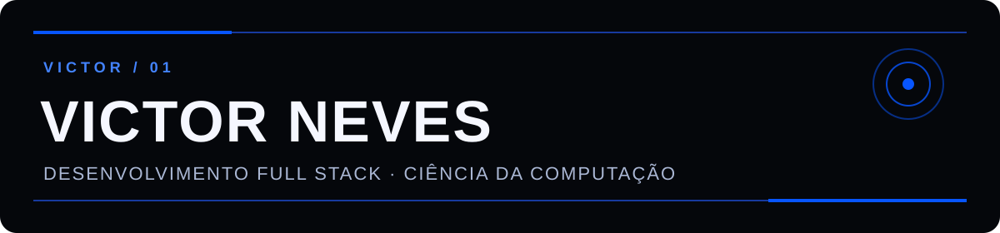

  

  <a href="https://github.com/VictorAugusto01?tab=repositories">Projetos</a> ·
  <a href="https://www.linkedin.com/in/victor-neves-augusto/">LinkedIn</a> ·
  <a href="https://portfolio-victor-neves.netlify.app/">Portfólio</a>

## Olá, eu sou o Victor

Sou desenvolvedor full stack e estudante de Ciência da Computação. Gosto de entender o problema, organizar os dados e construir uma solução que seja simples de usar e manter. Meu foco hoje está em backend, APIs e integração com interfaces web.

### Tecnologias que uso

`PHP` · `Laravel` · `JavaScript` · `TypeScript` · `Node.js` · `Python` · `PostgreSQL` · `MySQL`

### Projetos públicos

- **[API de prontuários](https://github.com/VictorAugusto01/teste-api-prontuarios)** — API REST em Laravel com autenticação e separação de responsabilidades. Projeto de teste técnico.
- **[Roteamento de ambulâncias](https://github.com/VictorAugusto01/ambul-ncia_atividade)** — aplicativo Android em Java desenvolvido em equipe como projeto acadêmico; usa busca em largura para localizar uma rota até um hospital com leitos disponíveis.
- **[Dia das Mulheres](https://github.com/VictorAugusto01/dia-das-mulheres)** — página interativa feita com HTML, CSS e JavaScript. Um projeto pessoal que também mostra meu cuidado com a experiência de quem usa.

  
O que estou estudando agora

   
  DevOps, cloud, arquitetura de serviços e segurança de APIs.

### Vamos conversar

<a href="https://www.linkedin.com/in/victor-neves-augusto/">LinkedIn</a> ·
<a href="https://portfolio-victor-neves.netlify.app/">Portfólio</a> ·
<a href="mailto:victornevesaugusto@gmail.com">E-mail</a>

  

