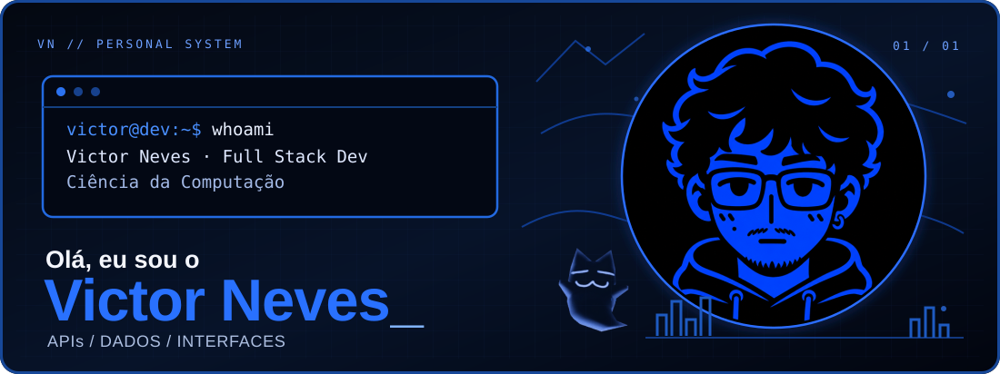
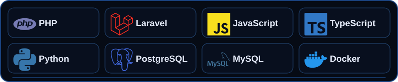
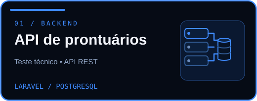
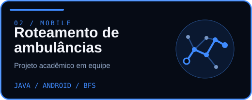
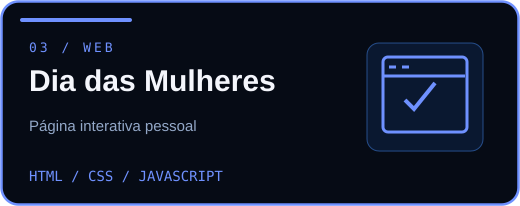
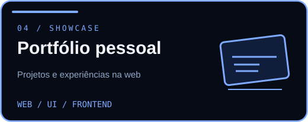

<!-- Identidade visual original: azul elétrico e preto. Sem CSS ou JavaScript executável. -->

  

  <a href="#sobre-mim">Sobre mim</a> &nbsp;·&nbsp;
  <a href="#tecnologias">Stack</a> &nbsp;·&nbsp;
  <a href="#projetos">Projetos</a> &nbsp;·&nbsp;
  <a href="#contato">Contato</a>

### Sobre mim

Sou o Victor, desenvolvedor full stack e estudante de Ciência da Computação na Universidade Cruzeiro do Sul. Gosto de trabalhar com **APIs, dados e interfaces**, pensando tanto na estrutura do código quanto na experiência de quem usa.

### Tecnologias

  

  
<b>O que estou explorando atualmente?</b>

   
  Aprofundando meus conhecimentos em arquitetura de software, DevOps, cloud e segurança de APIs, além de projetos pessoais em desenvolvimento web e automação.

### Projetos

<!-- Cada card é uma imagem clicável. As informações técnicas e a origem foram descritas com transparência. -->

  
  

  
  

  
<b>Sobre esses projetos</b>

- **API de prontuários:** desenvolvida como teste técnico, com Laravel, autenticação e separação de responsabilidades.
- **Roteamento de ambulâncias:** aplicativo Android desenvolvido **em equipe** como projeto acadêmico, utilizando busca em largura (BFS).
- **Dia das Mulheres:** página interativa pessoal com HTML, CSS e JavaScript.
- **Portfólio pessoal:** apresentação de projetos e experiências de desenvolvimento.

### Contato

  <a href="https://www.linkedin.com/in/victor-neves-augusto/">LinkedIn</a> &nbsp; • &nbsp;
  <a href="https://portfolio-victor-neves.netlify.app/">Portfólio</a> &nbsp; • &nbsp;
  <a href="mailto:victornevesaugusto@gmail.com">E-mail</a> &nbsp; • &nbsp;
  <a href="https://www.instagram.com/neves.sla/">Instagram</a>

  

Construir. Aprender. Ajustar. Repetir.

